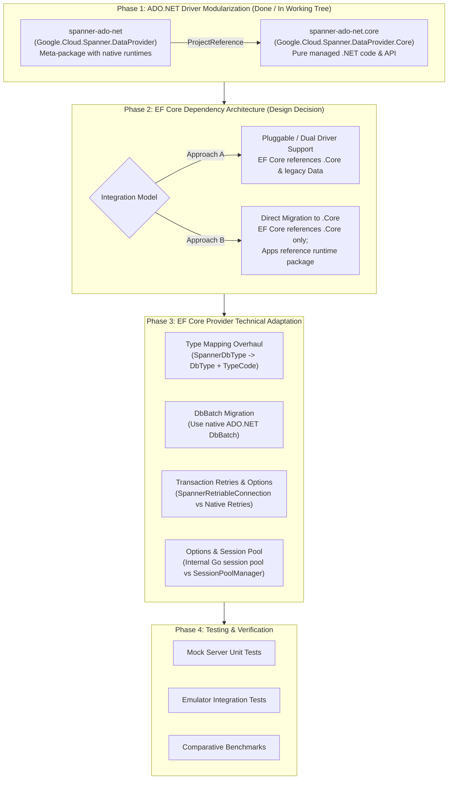

# Plan: Integrating EF Core Provider with Native-Backed Spanner ADO.NET Driver

## 1. Executive Summary & Objective

This repository contains two major components:
1. **[Google.Cloud.EntityFrameworkCore.Spanner](file:///Users/loite/RiderProjects/dotnet-spanner-entity-framework/Google.Cloud.EntityFrameworkCore.Spanner)**: The Entity Framework Core database provider for Google Cloud Spanner. Currently, it depends on the legacy pure C# ADO.NET driver [Google.Cloud.Spanner.Data](https://www.nuget.org/packages/Google.Cloud.Spanner.Data) (v5.x).
2. **[spanner-ado-net](file:///Users/loite/RiderProjects/dotnet-spanner-entity-framework/spanner-ado-net)**: The high-performance ADO.NET driver for Cloud Spanner backed by `spannerlib` (a native shared Go core running as a local IPC gRPC proxy from [googleapis/go-sql-spanner](https://github.com/googleapis/go-sql-spanner)).

### The Goal
Enable the Entity Framework Core provider to use the new native-backed ADO.NET driver for significantly improved throughput, lower memory allocations, and parity with features in the Go/SpannerLib ecosystem.

### The Packaging Challenge
The new ADO.NET driver bundles precompiled native binaries (`spannerlib_grpc_server`) for multiple OS architectures (`linux-x64`, `linux-arm64`, `osx-arm64`, `win-x64`), resulting in a large package footprint (~100MB+). Directly taking a dependency on this package in `Google.Cloud.EntityFrameworkCore.Spanner` would:
- Force heavy native assets onto all EF Core consumers indiscriminately.
- Hinder deployment flexibility in environments that do not require or cannot run the bundled native binaries.
- Make it difficult to offer the new driver as an optional or alternative backend to the existing pure C# driver.

---

## 2. Reconstructed Multi-Phase Plan



---

## 3. Phase Details & Status

### Phase 1: ADO.NET Driver Modularization (Status: Implemented in Working Tree)

Split the `spanner-ado-net` project into two separate NuGet packages:

1. **`Google.Cloud.Spanner.DataProvider.Core`** (`spanner-ado-net/spanner-ado-net.core/`):
   - Contains all managed ADO.NET classes: `SpannerConnection`, `SpannerCommand`, `SpannerDataReader`, `SpannerParameter`, `SpannerParameterCollection`, `SpannerTransaction`, `SpannerBatch`, `SpannerConnectionStringBuilder`, and gRPC IPC client logic.
   - Contains **zero native binary assets** (very lightweight NuGet package, <200 KB).
   - Intended for framework and library authors (such as EF Core) so they can compile against the ADO.NET types without forcing native binaries onto downstream consumers.
2. **`Google.Cloud.Spanner.DataProvider`** (`spanner-ado-net/spanner-ado-net/`):
   - References `Google.Cloud.Spanner.DataProvider.Core`.
   - Bundles native binaries under `runtimes/{rid}/native/` (`linux-x64`, `linux-arm64`, `osx-arm64`, `win-x64`).
   - Intended for end-user executable applications.

#### Current Status:
- [x] Extracted source files into [spanner-ado-net.core](file:///Users/loite/RiderProjects/dotnet-spanner-entity-framework/spanner-ado-net/spanner-ado-net.core/spanner-ado-net.core.csproj).
- [x] Configured [spanner-ado-net.csproj](file:///Users/loite/RiderProjects/dotnet-spanner-entity-framework/spanner-ado-net/spanner-ado-net/spanner-ado-net.csproj) to reference `.core` and package `runtimes/**`.
- [x] Added `spanner-ado-net.core` to [Google.Cloud.EntityFrameworkCore.Spanner.sln](file:///Users/loite/RiderProjects/dotnet-spanner-entity-framework/Google.Cloud.EntityFrameworkCore.Spanner.sln) and [spanner-ado-net.sln](file:///Users/loite/RiderProjects/dotnet-spanner-entity-framework/spanner-ado-net/spanner-ado-net.sln).
- [x] Updated [build.sh](file:///Users/loite/RiderProjects/dotnet-spanner-entity-framework/build.sh), [release-please-config.json](file:///Users/loite/RiderProjects/dotnet-spanner-entity-framework/release-please-config.json), and [.release-please-manifest.json](file:///Users/loite/RiderProjects/dotnet-spanner-entity-framework/.release-please-manifest.json).
- [x] Verified unit tests pass (375 tests passing).

---

### Phase 2: EF Core Dependency Architecture (Design Decision)

Determine how EF Core consumes the driver:

#### Strategy A: Dual-Driver / Pluggable Support (Optional Dependency)
- **Compile-time**: `Google.Cloud.EntityFrameworkCore.Spanner` references `Google.Cloud.Spanner.DataProvider.Core` as well as `Google.Cloud.Spanner.Data`.
- **Runtime**:
  - By default, existing users continue using `Google.Cloud.Spanner.Data` with no breaking changes.
  - Users opt into the native driver via:
    ```csharp
    options.UseSpanner(connectionString, b => b.UseNativeDataProvider());
    ```
    or by passing a `Google.Cloud.Spanner.DataProvider.SpannerConnection` instance.
  - When the native provider is chosen, the application references `Google.Cloud.Spanner.DataProvider` to supply the native runtime binaries.

#### Strategy B: Full Migration to `Google.Cloud.Spanner.DataProvider.Core` (Clean Cutover)
- Target the next major release (e.g. EF Core 10 provider).
- Replace `Google.Cloud.Spanner.Data` dependency completely with `Google.Cloud.Spanner.DataProvider.Core`.
- EF Core itself remains lightweight and pure managed code.
- Applications referencing `Google.Cloud.EntityFrameworkCore.Spanner` simply add `Google.Cloud.Spanner.DataProvider` to their executable project.

---

### Phase 3: EF Core Provider Technical Adaptations

The following technical differences between `Google.Cloud.Spanner.Data` and `Google.Cloud.Spanner.DataProvider.Core` must be addressed:

| Area | Legacy Driver (`Google.Cloud.Spanner.Data`) | New Driver (`Google.Cloud.Spanner.DataProvider.Core`) | EF Core Adaptation Required |
| :--- | :--- | :--- | :--- |
| **Namespace** | `Google.Cloud.Spanner.Data` | `Google.Cloud.Spanner.DataProvider` | Update `using` imports or create driver abstraction layer. |
| **Type System** | `SpannerDbType` custom enum & class (`SpannerDbType.Int64`, `SpannerDbType.ArrayOf(...)`) | Standard `System.Data.DbType` + `SpannerParameter.SpannerParameterType` (`Google.Cloud.Spanner.V1.Type`) | Refactor [SpannerTypeMappingSource](file:///Users/loite/RiderProjects/dotnet-spanner-entity-framework/Google.Cloud.EntityFrameworkCore.Spanner/Storage/Internal/SpannerTypeMappingSource.cs), [SpannerComplexTypeMapping](file:///Users/loite/RiderProjects/dotnet-spanner-entity-framework/Google.Cloud.EntityFrameworkCore.Spanner/Storage/Internal/SpannerComplexTypeMapping.cs), array mappings, and JSON mappings. |
| **CLR Types** | Uses custom `SpannerDate`, `SpannerNumeric` | Uses standard `DateOnly`, `Guid` (UUID), `decimal`, `float`, `double` | Update CLR type handlers to modern .NET primitives. |
| **Transaction Retries** | Handled in EF Core via [SpannerRetriableConnection](file:///Users/loite/RiderProjects/dotnet-spanner-entity-framework/Google.Cloud.EntityFrameworkCore.Spanner/Storage/Internal/SpannerRetriableConnection.cs) & [SpannerRetriableTransaction](file:///Users/loite/RiderProjects/dotnet-spanner-entity-framework/Google.Cloud.EntityFrameworkCore.Spanner/Storage/Internal/SpannerRetriableTransaction.cs) with checksum tracking | `spannerlib` runs on Go's `go-sql-spanner` core, which natively handles connection management and transaction lifecycle | Review abort retry handling: evaluate whether to delegate retries directly to `spannerlib` or retain EF Core's checksum verification wrapper. |
| **Batch DML** | Custom `SpannerBatchCommand` / `SpannerBatch` | Standard ADO.NET `DbBatch` and `DbBatchCommand` | Update [SpannerModificationCommandBatch](file:///Users/loite/RiderProjects/dotnet-spanner-entity-framework/Google.Cloud.EntityFrameworkCore.Spanner/Update/Internal/SpannerModificationCommandBatch.cs) to leverage EF Core 7+ native `DbBatch` support. |
| **Session Pooling** | Managed in C# via `SessionPoolManager` passed to `SpannerConnectionStringBuilder` | Managed internally in Go proxy (`spannerlib`) | Remove `SessionPoolManager` setup from [SpannerDbContextOptionsExtensions](file:///Users/loite/RiderProjects/dotnet-spanner-entity-framework/Google.Cloud.EntityFrameworkCore.Spanner/Extensions/SpannerDbContextOptionsExtensions.cs) when using the new driver. |
| **Exceptions** | `SpannerException` | `SpannerDbException` (derived from `DbException`) | Update exception translation and error handling in [SpannerRelationalConnection](file:///Users/loite/RiderProjects/dotnet-spanner-entity-framework/Google.Cloud.EntityFrameworkCore.Spanner/Storage/Internal/SpannerRelationalConnection.cs). |

---

### Phase 4: Testing & Verification

1. **Unit Tests**:
   - Verify all tests in [Google.Cloud.EntityFrameworkCore.Spanner.Tests](file:///Users/loite/RiderProjects/dotnet-spanner-entity-framework/Google.Cloud.EntityFrameworkCore.Spanner.Tests) pass against the in-process mock server (`MockSpannerServer.cs`).
2. **Integration Tests**:
   - Run end-to-end integration tests in [Google.Cloud.EntityFrameworkCore.Spanner.IntegrationTests](file:///Users/loite/RiderProjects/dotnet-spanner-entity-framework/Google.Cloud.EntityFrameworkCore.Spanner.IntegrationTests) against the Spanner Emulator (`SPANNER_EMULATOR_HOST=localhost:9010`).
   - Validate migrations, scaffolding, CRUD, interleaved tables, and transaction retries.
3. **Benchmarks**:
   - Run benchmarks in [Google.Cloud.EntityFrameworkCore.Spanner.Benchmarks](file:///Users/loite/RiderProjects/dotnet-spanner-entity-framework/Google.Cloud.EntityFrameworkCore.Spanner.Benchmarks) comparing execution throughput and memory allocations between legacy `Google.Cloud.Spanner.Data` and `Google.Cloud.Spanner.DataProvider`.

---

## 4. Immediate Next Steps

1. **Review Working Tree Changes**:
   - Ensure `spanner-ado-net.core` refactoring is clean and all tests in `spanner-ado-net-tests` continue to pass.
2. **Decide between Strategy A (Dual-Driver) vs Strategy B (Full Migration)**.
3. **Begin EF Core Type Mapping Adaptation**:
   - Create adapters or update [SpannerTypeMappingSource](file:///Users/loite/RiderProjects/dotnet-spanner-entity-framework/Google.Cloud.EntityFrameworkCore.Spanner/Storage/Internal/SpannerTypeMappingSource.cs) to eliminate direct coupling to `SpannerDbType`.
